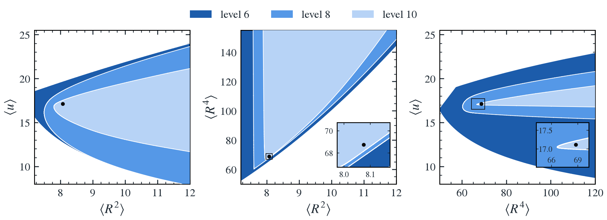

# SU(2) BFSS moment bootstrap

Rigorous bounds on the ground state of the SU(2) BFSS matrix model (two
D0-branes, sixteen supercharges), from positivity, symmetry and supersymmetry
alone. At level $`L`$ the program takes every operator of level at most $`L`$,
organizes them into $`\mathrm{SU}(2)\times\mathrm{Spin}(9)`$ multiplets,
imposes all the Ward identities that follow from the ground state being
annihilated by $`H`$, the supercharges, the Gauss law and the rotations,
reduces everything exactly to a small semidefinite program, solves it with
SDPB, and certifies the bounds in exact arithmetic.

At levels 6, 8 and 10 the certified lower bounds on $`\langle R^2\rangle`$
are 6.85, 7.49 and 7.798212232943. `RESULTS.md` has every number and the
compute each level took.



Allowed regions in the $`(\langle R^2\rangle, \langle u\rangle)`$,
$`(\langle R^2\rangle, \langle R^4\rangle)`$ and
$`(\langle R^4\rangle, \langle u\rangle)`$ planes at levels 6 (darkest), 8
and 10 (lightest), where $`u`$ is the bosonic potential. The black point is
an independent variational wavefunction; the insets zoom on the tips.

A guide to the code, next to the paper, is at <https://michel.ac/SU2-BFSS/>.
`bfss/` has one module per step, in the order kinematics → model → basis →
pairing → moments → reduction → problem → sdp, certify → regions → plots;
`run.py` is the command line.

## Installing

```sh
git clone <this repository> && cd <it>/bootstrap
python -m venv .venv && source .venv/bin/activate
pip install -r requirements.txt
```

Python 3.10 or later. Certified bounds also need
[SDPB](https://github.com/davidsd/sdpb) 3 (`sdpb` and `pmp2sdp`) with an MPI
launcher, found on the `PATH`, in the directory named by `SDPB_BIN`, or inside
a Singularity image named by `SDPB_IMAGE` (run with `singularity exec
--cleanenv --env`: SingularityCE 3.6 or later, or Apptainer). Without SDPB
everything but the certified solves works, with the double-precision solver
Clarabel.

## Use

Level 6 is small enough for a laptop:

```sh
# exact problem: runs/L6/problem.json
python run.py compile --level 6 --workers 4 --out runs/L6
# quick estimate with Clarabel
python run.py solve runs/L6 --min R2
# the bound with SDPB, checked against the exact problem
python run.py solve runs/L6 --min R2 --backend sdpb
# exact certificate of that solve
python run.py certify runs/L6 --name tip
```

Level 8 compiles in about 20 minutes on 32 cores; level 10 took about a day
on several 112-core servers with up to 46 GB per worker.

```sh
python run.py compile --level 10 --workers 64 --out runs/L10
# optional: further primes as separate jobs, before a final plain compile
python run.py compile --level 10 --workers 48 --out runs/L10 --primes 1
python run.py solve runs/L10 --min R2 --backend sdpb --procs 32
# maximize <u> at fixed <R^2>
python run.py solve runs/L10 --min=-u --fix R2=12 --backend sdpb
# allowed regions -> regions.json, then figures
python run.py scan runs/L10 --n 24 --workers 14 --procs 8 \
    --lower runs/L6 runs/L8
python run.py plot runs/L6 runs/L8 runs/L10 --out figures
```

Objectives are combinations of `R2 R4 u T Y D P2 P4`, such as `u+1/2*R2`;
constraints take exact rationals. Compiles and scans resume after an
interruption. `SDPB_THREADS` sets the OpenMP threads of each SDPB solve.

## Tests

```sh
# the algebra and every model identity, exactly
python tests/check_model.py
# weight coordinates, products, adjoints, pairings, null multiplets
python tests/check_pairing.py
# level 8, blocks up to dimension 3000, 32 workers:
# explicit pairings vs. fast evaluation
python tests/check_problem.py 8 3000 32
# multiplets, rows and sizes per irrep at level 10
python tests/basis_stats.py 10 32
```
